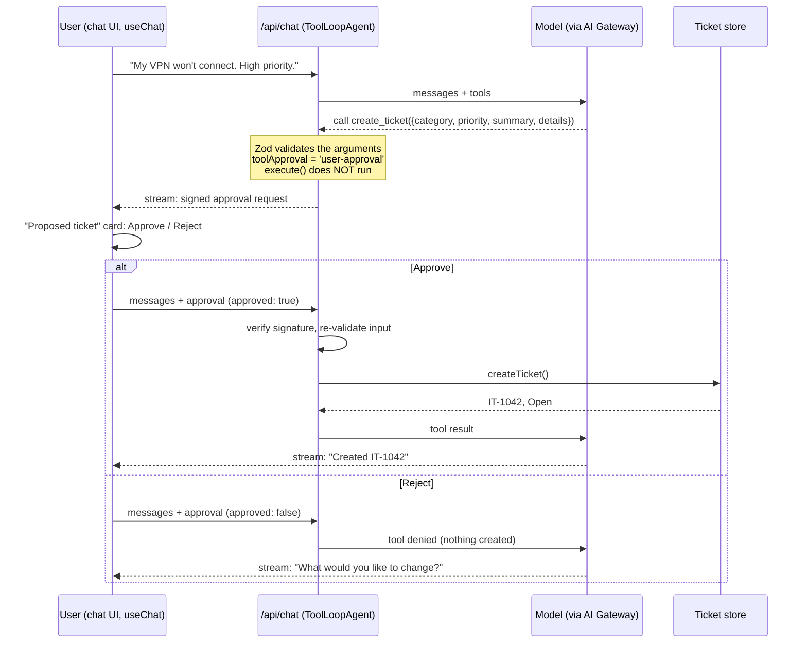

# IT Help Desk Agent with Human Approval

An IT help desk agent built with Next.js and the Vercel AI SDK. It turns plain-English requests into tickets, but it never creates one until a person approves it.

**Live demo:** _coming soon_ <!-- replace with https://<your-project>.vercel.app -->


## Why approval matters

An agent that only answers questions can be wrong without causing much harm. An agent that takes actions, such as filing tickets, changing access, or spending money, needs a checkpoint. Here the model can only *propose* an action. The server pauses before the side effect, shows the exact arguments to a human, and acts only after an explicit Approve. The approval is enforced on the server and signed, so the browser can't skip it or fake it.

## How it works



`list_tickets` is read-only, so it runs without approval. The agent must call it for any question about existing tickets.

## Design choices

- **Approval gate (server-side).** The AI SDK has built-in tool approval. [`src/lib/agent.ts`](src/lib/agent.ts) sets `toolApproval: { create_ticket: 'user-approval' }` on the `ToolLoopAgent`. When the model calls the tool, the SDK streams an approval request instead of running `execute`. The UI ([`ticket-card.tsx`](src/components/ticket-card.tsx)) renders the request and calls `addToolApprovalResponse`, and `useChat` resubmits with `sendAutomaticallyWhen: lastAssistantMessageIsCompleteWithApprovalResponses`. I used the built-in mechanism instead of a hand-rolled client confirmation because enforcement then sits in the agent loop, not in UI code that a client could bypass.
- **Signed approvals.** With `useChat` the client sends the full history each turn, so it could try to send an "approved" response the server never issued. `experimental_toolApprovalSecret` HMAC-signs each approval request and rejects unsigned or tampered approvals before the tool runs. A test covers this.
- **Schema validation.** Tool arguments are checked against a Zod schema (category and priority enums, length limits) before approval and again before execution. Invalid proposals become a tool error the model and user can see, and nothing is created.
- **Live data through tools.** Facts about existing tickets come from `list_tickets`, never from the conversation. The system prompt also forbids claiming a ticket exists without a returned ticket ID.
- **Streaming.** [`/api/chat`](src/app/api/chat/route.ts) returns `createAgentUIStreamResponse`, so text, tool calls, approval requests and results stream to the browser as they happen.
- **Model access through AI Gateway.** The model is a plain string (`anthropic/claude-sonnet-5.5`, override with `AI_MODEL`). On Vercel it authenticates through OIDC with no key to manage. AI Gateway's free monthly credits work on the Hobby plan, but Vercel requires a credit card on the account to unlock them.

## Tests

`npm test` runs [`tests/approval-flow.test.ts`](tests/approval-flow.test.ts) against a scripted mock model, with no API key needed. It checks four things:

- Approve creates `IT-1042`, and nothing exists before the approval.
- Reject creates nothing.
- A forged approval without a server signature is refused.
- Arguments that fail the schema (e.g. `category: "printer"`) create nothing.

## Limits and next steps

- **In-memory store.** Tickets reset on every redeploy or cold start, and separate serverless instances don't share them. Next: a database or a real ticketing system (ServiceNow, Jira).
- **Durable approvals.** A pending approval lives only in the browser tab. A durable workflow (Vercel Workflow / `WorkflowAgent`) would let approvals wait hours, survive reloads, and be handled by someone else.
- **No auth.** Everyone shares one ticket list. Next: sign-in, per-user tickets, and role-based approval rules (e.g. auto-approve low priority, require a manager for access requests).
- **Observability and quality.** Add an audit log of who approved what, evals for request parsing, and rate limiting.

## Run locally

Requires Node.js 22+.

```bash
npm install
cp .env.example .env.local
```

In `.env.local`, set:

- `AI_GATEWAY_API_KEY`: create one in the Vercel dashboard under **AI Gateway → API Keys**. The account needs a credit card on file to unlock the free credits.
- `TOOL_APPROVAL_SECRET`: generate with `openssl rand -base64 32`.

```bash
npm run dev
```

Open http://localhost:3000. To run the tests:

```bash
npm test
```

## Deploy to Vercel

1. Push this repo to GitHub.
2. In Vercel, choose **Add New → Project**, import the repo, and keep the detected Next.js settings.
3. Under **Settings → Environment Variables**, add `TOOL_APPROVAL_SECRET` (a new random value). You don't need `AI_GATEWAY_API_KEY` on Vercel, because the deployment authenticates to AI Gateway with OIDC.
4. Deploy, then open the URL and try an approve, a reject, and "What tickets do I have open?".

## Project layout

```
src/lib/agent.ts             agent, tools, Zod schema, approval policy
src/lib/ticket-store.ts      in-memory mock ticket store
src/app/api/chat/route.ts    streaming chat endpoint
src/app/page.tsx             chat UI (useChat)
src/components/ticket-card.tsx  proposed / created / rejected ticket card
tests/approval-flow.test.ts  approval gate tests with a mock model
```
